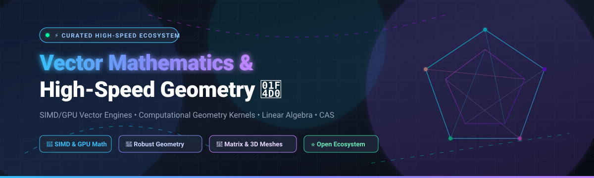

  

# Awesome Vector Mathematics & High-Speed Geometry 📐⚡

  
  
  
  
  

---

## 🧭 Executive Summary & Ecosystem Overview

Welcome to the definitive **Vector Mathematics & High-Speed Computational Geometry** directory. This curated repository catalogs the highest-performing **SaaS/Hosted computational platforms** and elite **open-source libraries** across C++, Rust, Python, Julia, and JavaScript/TypeScript.

Whether you are building 3D graphics rendering engines, CAD/CAM spatial modeling kernels, real-time collision detection systems, robotics trajectory solvers, high-frequency trading (HFT) quantitative backends, or scientific machine learning pipelines, this guide tracks the battle-tested primitives powering modern vector arithmetic, exact geometric predicates, mesh triangulations, and SIMD/GPU tensor math.

---

## 📊 Sector Overview & Market Dynamics

The global **computational mathematics, engineering simulation, and spatial geometry software market** is estimated at **$14.2 Billion in 2026** (spanning technical computing platforms, finite-element geometric analysis, CAD kernels, and scientific numerical software), expanding at an estimated **11.4% CAGR**.

Market dynamics within this sector exhibit **distinct bifurcated concentration**:
- **SaaS & Enterprise Engineering Software**: Heavily concentrated and dominated by deeply entrenched legacy ecosystems (**MathWorks MATLAB**, **Dassault Systèmes**, **PTC**, **Autodesk**, and **Wolfram Research**) benefiting from massive multi-decade institutional moats, proprietary kernel IP, and educational pipeline lock-in.
- **Developer Libraries & Open-Source Engine Space**: Moderately fragmented with rapid decentralized innovation across Rust, C++, and Python. Developers increasingly decouple from monolithic closed platforms in favor of modular, zero-cost abstraction libraries (**CGAL**, **GLM**, **glam**, **JAX**, **Eigen**) that integrate natively with modern SIMD intrinsics (AVX-512, ARM Neon) and GPU compute runtimes (CUDA, ROCm, WebGPU).

---

## 📑 Table of Contents

- [📊 Sector Overview & Market Dynamics](#-sector-overview--market-dynamics)
- [☁️ SaaS & Hosted Computational Platforms](#️-saas--hosted-computational-platforms)
- [⚡ Open-Source GitHub Projects & Libraries](#-open-source-github-projects--libraries)
- [📈 Star History](#-star-history)
- [💖 Support & Contributing](#-support--contributing)
- [📜 License](#-license)

---

## ☁️ SaaS & Hosted Computational Platforms

The table below features the premier hosted computational geometry environments, dynamic graphing engines, and computer algebra systems (CAS), ranked in descending order by parent company scale (revenue / market valuation).

| 🏢 Platform | 💰 Starting Tier Pricing | 🎁 Free Tier Limits | 🏢 Company Scale (Rev / Valuation) | 🎯 Core Focus & Key Capabilities |
| :--- | :--- | :--- | :--- | :--- |
| **[Photomath](https://photomath.com)** | **$9.99/mo** (Photomath Plus) or **$59.99/yr** | **Free forever plan**: Unlimited step-by-step arithmetic, algebraic, and basic geometry graphing solutions; animated tutorials gated to Plus. | **Parent: Alphabet / Google (~$2.2T Valuation)** | 📱 Camera-driven AI optical formula parser, instant geometry solver, and step-by-step calculus engine. |
| **[Desmos Graphing & Geometry](https://desmos.com)** | **$0.00** (Core tools 100% free; institutional Amplify Desmos Math curriculum licensed per school/district starting at **~$5,000/yr**) | **Free forever plan**: 100% unrestricted access to 2D Graphing Calculator, 3D Vector Grapher, and Euclidean Geometry toolkits with infinite cloud graph saves. | **Parent: Amplify (~$2.0B Valuation)** | ⚡ Ultra-smooth 60fps web graphing engine, interactive 2D/3D coordinate geometry, transformations, and parametric equations. |
| **[MATLAB Online](https://mathworks.com)** | **$99/yr** (Home license) or **$250/yr** (Standard individual annual subscription) | **30-day free trial**: Full desktop and cloud access with complete computational geometry and vector math toolboxes during trial; no ongoing free tier. | **MathWorks (~$1.5B+ Annual Revenue)** | 📐 Gold-standard numerical matrix laboratory, vectorized linear algebra, computational geometry toolboxes, and cloud browser IDE. |
| **[Mathway](https://mathway.com)** | **$9.99/mo** or **$39.99/yr** (Chegg Mathway Premium) | **Free forever plan**: Unlimited equation solving and coordinate graphing answers; detailed step-by-step mathematical proofs require paid tier. | **Parent: Chegg (~$400M Valuation)** | 🔢 Step-by-step multivariable vector algebra solver, 2D/3D coordinate transformations, and calculus helper. |
| **[Wolfram Alpha & Wolfram Cloud](https://wolframalpha.com)** | **$7.00/mo** ($5.00/mo billed annually for Wolfram\|Alpha Pro) | **Free forever plan**: Unlimited standard natural-language queries with standard computing time per query (step-by-step vector mechanics & Wolfram Notebooks require Pro). | **Wolfram Research (~$150M+ Revenue)** | 🧠 Computational knowledge engine delivering exact symbolic vector analysis, tensor calculus, differential geometry, and 3D surface plotting. |
| **[Maple Cloud & Maple Learn](https://maplesoft.com)** | **$12.00/mo** or **$119/yr** (Maple Learn Premium personal tier) | **Free forever plan**: Up to 5 private documents and unrestricted public dynamic math canvases; 15-day full-feature trial for desktop engine. | **Maplesoft / Cybernet (~$100M+ Revenue)** | 📝 Interactive mathematical documents, symbolic vector calculus, differential geometry plots, and analytical modeling. |
| **[GeoGebra Cloud](https://geogebra.org)** | **$0.00** (Free for non-commercial users; commercial SDK & OEM licensing starts at **~$3,500/yr**) | **Free forever plan**: Full dynamic Euclidean geometry suite, 3D vector spatial graphing calculator, CAS, and unlimited worksheet storage. | **Parent: BYJU'S (Formerly ~$22B; Restructuring)** | 🌐 Dynamic geometric constructions, real-time vector cross/dot product visualizer, and stereoscopic 3D coordinate viewer. |
| **[Observable](https://observablehq.com)** | **$20.00/user/mo** (Observable Pro billed annually) | **Free forever plan**: Unlimited public computational notebooks, 5 private notebooks, and full access to D3.js and WebGL canvas primitives. | **Observable Inc. (~$50M+ Total Funding)** | 📊 Reactive canvas notebooks built for WebGL/SVG computational geometry algorithms, Voronoi tessellations, and vector field visualizers. |
| **[JuliaHub](https://juliahub.com)** | **$15.00/user/mo** plus cloud compute usage from **$0.20/hour** | **Free forever plan**: Community platform access with limited CPU hours and public registry package simulation capabilities. | **JuliaHub Inc. (~$35M+ Total Funding)** | 🚀 Cloud-native scientific computing platform optimized for high-throughput Julia vector math and GPU-accelerated linear algebra. |
| **[Symbolab](https://symbolab.com)** | **$2.49/wk** or **$6.99/mo** or **$29.99/yr** (Symbolab Pro) | **Free forever plan**: Basic answer generation and coordinate plotting; detailed step-by-step vector matrix decompositions require Pro. | **Parent: Course Hero (~$3.6B Valuation)** | 🧩 Interactive symbolic geometry, dot/cross vector calculations, matrix operations, and coordinate transformations. |
| **[CoCalc](https://cocalc.com)** | **$14.00/mo** (Standard Personal Plan with dedicated CPU allocation) | **Free forever plan**: Collaborative shared compute access to SageMath, Python, Julia, and R notebooks (trial server with network egress limits). | **SageMath Inc. (Bootstrapped / ~$5M Valuation)** | 🤝 Collaborative cloud mathematics workspace executing full open-source CAS engines (SageMath, NumPy, SymPy, Maxima). |

---

## ⚡ Open-Source GitHub Projects & Libraries

Below are the most prominent and high-performance open-source repositories powering vector mathematics, SIMD linear algebra, spatial indexing, mesh triangulation, and computational geometry kernels. Sorted in descending order by GitHub Stars ⭐.

| 📦 Repository & Link | ⭐ GitHub Stars | 🏷️ Primary Language | 🛠️ Architecture & Specialization |
| :--- | :---: | :---: | :--- |
| **[three.js](https://github.com/mrdoob/three.js)** |  | JavaScript | Industry-standard WebGL/WebGPU 3D library containing comprehensive, highly optimized Vector2/3/4, Matrix3/4, Quaternion, Ray, Frustum, Box3, and Sphere spatial math classes. |
| **[Julia Base & LinearAlgebra](https://github.com/JuliaLang/julia)** |  | Julia / C++ | LLVM-compiled high-performance dynamic programming language engineered from the ground up for technical vector math, dense/sparse matrices, and native SIMD vectorization. |
| **[Manim Community](https://github.com/ManimCommunity/manim)** |  | Python | Programmatic mathematical animation engine rendering high-precision vector fields, coordinate transformations, and geometric constructions with Cairo and OpenGL. |
| **[JAX](https://github.com/jax-ml/jax)** |  | Python / C++ | Composable transformations of Python+NumPy code with XLA hardware acceleration (`jit`, `vmap`, `grad`) for ultra-high-throughput vector and matrix math on CPU, GPU, and TPU. |
| **[NumPy](https://github.com/numpy/numpy)** |  | Python / C | The foundational array and vector computing stack for Python, delivering AVX-512/Neon SIMD-accelerated linear algebra, matrix decomposition, and N-dimensional broadcast math. |
| **[TurboVec](https://github.com/RyanCodrai/turbovec)** |  | C++ / CUDA | Ultra-fast SIMD/GPU vector mathematics engine engineered specifically for low-latency graphics rendering, physical simulation, and high-speed geometry operations. |
| **[SciPy](https://github.com/scipy/scipy)** |  | Python / C++ | Fundamental scientific computing ecosystem including `scipy.spatial` (KD-trees, Voronoi diagrams, Delaunay triangulations, Qhull convex hulls) and sparse BLAS matrix routines. |
| **[SymPy](https://github.com/sympy/sympy)** |  | Python | Full-featured computer algebra system (CAS) for symbolic vector calculus, analytic geometry entities (planes, lines, polygons), coordinate transformations, and exact solutions. |
| **[Open3D](https://github.com/isl-org/Open3D)** |  | C++ / Python | Modern open-source library for 3D vector geometry processing, point cloud registration, KD-tree nearest neighbors, mesh reconstruction, and tensor-accelerated spatial pipelines. |
| **[CuPy](https://github.com/cupy/cupy)** |  | Python / CUDA | Drop-in NumPy/SciPy replacement accelerated with NVIDIA CUDA and AMD ROCm for massive parallel vector calculations, dense matrix factorizations, and custom CUDA kernels. |
| **[GLM (OpenGL Mathematics)](https://github.com/g-truc/glm)** |  | C++ | Header-only C++ mathematics library strictly adhering to GLSL specifications with SIMD vector and matrix intrinsics (SSE2, AVX2, Neon) for games and 3D graphics software. |
| **[meshoptimizer](https://github.com/zeux/meshoptimizer)** |  | C++ | High-performance geometry processing library for GPU vertex cache optimization, triangle overdraw reduction, SIMD vertex fetch decoding, and mesh level-of-detail simplification. |
| **[CGAL](https://github.com/CGAL/cgal)** |  | C++ | The gold-standard Computational Geometry Algorithms Library providing robust, exact predicates, 2D/3D Delaunay triangulations, Voronoi diagrams, boolean operations, and surface meshing. |
| **[gl-matrix](https://github.com/toji/gl-matrix)** |  | JavaScript | High-speed JavaScript vector, matrix, and quaternion math library specifically tuned for WebGL, WebGPU, and interactive browser-based 3D applications. |
| **[libigl](https://github.com/libigl/libigl)** |  | C++ | Header-only geometry processing library built on top of Eigen, widely adopted in graphics research for discrete differential geometry, geodesic distances, and parameterization. |
| **[nalgebra](https://github.com/dimforge/nalgebra)** |  | Rust | General-purpose linear algebra library for Rust featuring statically- and dynamically-sized matrices, coordinate frames, SIMD vectors, and projective geometric transformations. |
| **[Shapely](https://github.com/shapely/shapely)** |  | Python / C | Planar spatial geometry library backed by GEOS, providing vector operations for topological spatial predicates, buffer creation, union/intersection clipping, and polygon simplification. |
| **[Mafs](https://github.com/stevenpetryk/mafs)** |  | TypeScript | Declarative React library for creating interactive, Desmos-grade mathematical visualizations, vector field plots, dynamic coordinate grids, and geometric constructions. |
| **[SageMath](https://github.com/sagemath/sage)** |  | Python / Cython | Comprehensive open-source mathematics system aggregating NumPy, SciPy, SymPy, Maxima, and FLINT into an open-source alternative to Magma, Maple, and Mathematica. |
| **[earcut](https://github.com/mapbox/earcut)** |  | JavaScript | The fastest, most robust 2D polygon triangulation library in JavaScript for WebGL, GIS vector tiles, and 3D mesh rendering based on modified ear-clipping algorithms. |
| **[glam](https://github.com/bitshifter/glam-rs)** |  | Rust | Simple, ultra-fast 3D math library for Rust using SIMD-accelerated 2D/3D/4D vectors, matrices, and quaternions designed specifically for game engines and real-time graphics. |
| **[geo (GeoRust)](https://github.com/georust/geo)** |  | Rust | Comprehensive geospatial planar geometry algorithms and primitives in Rust, featuring line string clipping, concave/convex hulls, polygon booleans, and spatial indexing. |
| **[GEOS](https://github.com/libgeos/geos)** |  | C++ | C++ port of the Java Topology Suite (JTS) implementing OpenGIS Simple Features for planar computational geometry predicates, spatial indexing, and topological booleans. |
| **[JSXGraph](https://github.com/jsxgraph/jsxgraph)** |  | JavaScript | Cross-browser interactive dynamic geometry, function plotting, and vector construction library written in pure JavaScript supporting SVG, Canvas, and VML. |
| **[Parry](https://github.com/dimforge/parry)** |  | Rust | High-performance 2D and 3D collision-detection and computational geometry library in Rust providing BVH trees, ray-casting, GJK/EPA distance queries, and convex decomposition. |
| **[Spade](https://github.com/Stoeoef/spade)** |  | Rust | Pure-Rust 2D computational geometry crate delivering precise, high-speed Delaunay triangulations, constrained triangulations, and Voronoi diagram generation. |

---

## 📈 Star History

---

## 💖 Support & Contributing

Contributions are always warmly welcomed! 🌟 Whether you want to suggest a new high-speed vector math crate, add a computational geometry engine, or correct pricing and capability data, please feel free to submit a pull request.

- **⭐ Star the Repository**: If this curated list helped your development or research, please star and fork this repository!
- **📢 Share with Friends**: Share this repository with graphics engineers, game devs, and data scientists on X (Twitter), Reddit, and Discord.
- **☕ Buy Me a Coffee / Sponsor**: If you'd like to support the ongoing maintenance and curation of this and other open-source Awesome lists, please consider sponsoring:
  👉 **[Sponsor Dashboard on GitHub](https://github.com/sponsors/ishandutta2007)**

---

## 📜 License

Distributed under the [MIT License](LICENSE). Copyright © 2026 Ishan Dutta.
